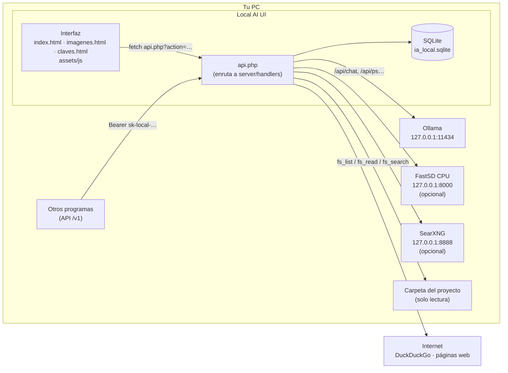
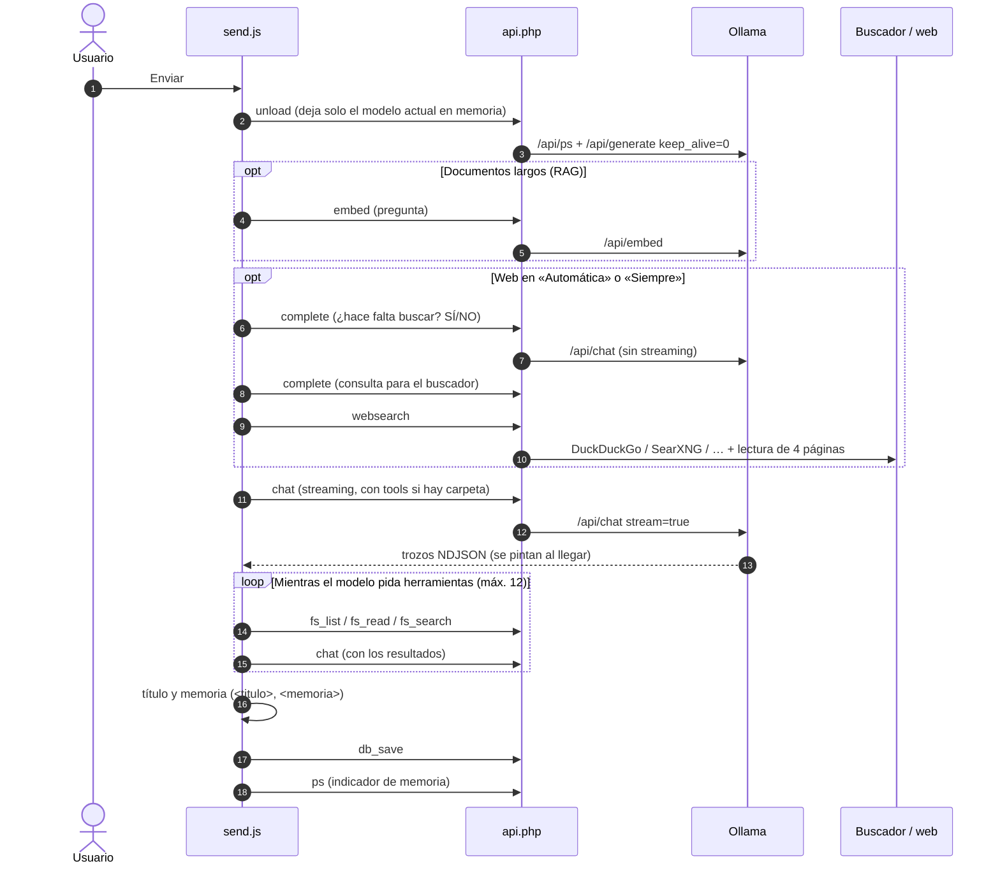

# Arquitectura

Local AI UI es una aplicación web clásica (HTML + JavaScript sin framework + PHP) que habla con **Ollama** en el mismo PC.
Funciona de dos maneras con el mismo código:

| Modo | Servidor web | Ventana | Datos |
| --- | --- | --- | --- |
| **XAMPP** (desarrollo) | Apache + PHP de XAMPP | Cualquier navegador | `data/ia_local.sqlite` y `galeria/` dentro del proyecto |
| **App de escritorio** (`.exe`) | PHP portátil (`php -S`) + `desktop/router.php` | Electron | `%APPDATA%\Local AI UI\data` |

## Visión general

La interfaz **nunca** habla directamente con Ollama ni con internet: todo pasa por `api.php`. Eso permite que la misma página
funcione en el navegador y en Electron, y concentra en el servidor las comprobaciones de seguridad (rutas, IP de origen, claves).

## Capas

### 1. Interfaz (`index.html`, `imagenes.html`, `claves.html`, `assets/`)

- Tres páginas independientes que comparten `assets/css/styles.css`, `assets/js/common.js`, `assets/js/icons.js` y el motor de idiomas.
- El chat está repartido en **scripts clásicos** (no módulos ES) dentro de `assets/js/chat/`: todos comparten el ámbito global y
  el **orden de carga de `index.html` importa** (un archivo puede usar funciones de otro siempre que se llamen después de cargar todos).
- Las librerías externas están copiadas en `assets/vendor/` (no se usa ningún CDN), así que la interfaz funciona sin internet.
- Detalle: [frontend.md](frontend.md).

### 2. Servidor (`api.php`, `server/`)

- `api.php` es el único punto de entrada. Lee `?action=` (o la ruta `/v1/...` estilo OpenAI) y carga **un** archivo de `server/handlers/`.
- `server/lib/` contiene lo compartido: base de datos, HTTP/raspado y buscadores.
- `server/config.php` lee las direcciones de Ollama/FastSD y la carpeta de datos (también desde variables de entorno, que es como la configura la app de escritorio).
- Detalle: [backend.md](backend.md) · referencia de acciones: [api.md](api.md).

### 3. Datos (SQLite)

Un único archivo `ia_local.sqlite` en modo WAL con seis tablas: `chats`, `images`, `memories`, `settings`, `api_keys`, `gallery`.
Las tablas se crean solas la primera vez. Esquema completo en [backend.md](backend.md#base-de-datos).

### 4. App de escritorio (`desktop/`)

Electron arranca el PHP portátil con `router.php` (que hace el papel de Apache y los `.htaccess`), espera a que responda y abre
la interfaz en su ventana. Además abre Ollama si está instalado pero cerrado y libera la memoria de los modelos al salir.
Detalle: [escritorio.md](escritorio.md).

## Recorrido de un mensaje

Lo que ocurre desde que pulsas **Enviar** hasta que la respuesta queda guardada (función `send()` en `assets/js/chat/send.js`):

Cada paso opcional se explica en [funciones.md](funciones.md).

## Decisiones de diseño

| Decisión | Motivo |
| --- | --- |
| PHP sin framework y JS sin bundler | El proyecto nació para XAMPP: copiar la carpeta y abrir el navegador. Sin paso de compilación. |
| Un archivo por tema en `assets/js/chat/` | Archivos pequeños y fáciles de localizar, sin necesidad de herramientas de build. |
| SQLite en vez de MySQL | Un solo archivo, sin servidor: imprescindible para el `.exe`. Para traer los datos antiguos está `server/tools/importar-mysql.php`. |
| Librerías en `assets/vendor/` | Funcionar sin internet y que el `.exe` no dependa de un CDN. |
| PHP integrado (`php -S`) en el `.exe` | Evita empaquetar Apache. Contrapartida: en Windows atiende una petición a la vez. |
| La IA no escribe en la carpeta del proyecto | Los modelos locales se equivocan más; la lectura es útil y no tiene riesgo. |
| Ediciones BUSCAR/REEMPLAZAR en texto | Funcionan con cualquier modelo (no requieren *tool calling*) y ahorran tokens frente a reescribir el archivo. |
