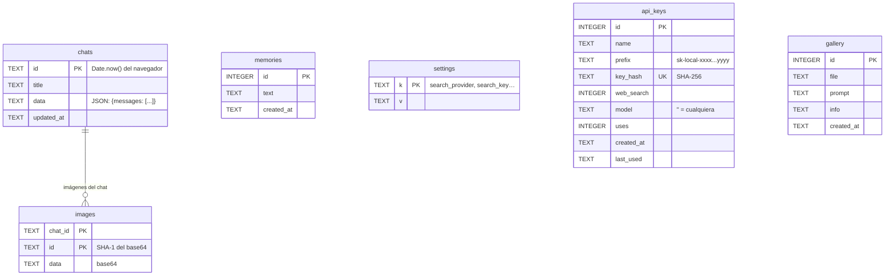

# Servidor (PHP)

Todo el servidor es PHP 8 sin dependencias de Composer. Extensiones necesarias: **curl**, **pdo_sqlite**, **mbstring**,
**openssl** (HTTPS), **dom** (lectura de DuckDuckGo) y **fileinfo**. `pdo_mysql` solo hace falta para el importador.

```
api.php                     Punto de entrada: enruta cada acción a un handler
server/
├── .htaccess               Prohíbe abrir server/ desde el navegador (Apache)
├── config.php              Direcciones de Ollama y FastSD, carpeta de datos
├── lib/
│   ├── database.php        Conexión SQLite, creación de tablas, utilidades
│   ├── http.php            Peticiones cURL, URL seguras, lectura de páginas web
│   └── search.php          Buscadores (DuckDuckGo, SearXNG, Ollama, Tavily, Google)
├── handlers/               Un archivo por grupo de acciones (ver tabla)
└── tools/
    └── importar-mysql.php  Importa los datos de la versión con MySQL (solo consola)
```

## `api.php`: enrutado

1. Define `IA_LOCAL` y `ROOT_DIR`, quita el límite de tiempo (`set_time_limit(0)`) y carga `server/config.php`.
2. Lee la acción de `?action=` (por defecto `chat`).
3. Si la ruta es `api.php/v1/...` (estilo OpenAI), fija la acción en `v1` y guarda la ruta en `$ROUTE_PATH`
   (`PATH_INFO`, o se extrae de `REQUEST_URI` si Apache no la da).
4. Comprueba que cURL esté activo, carga las tres librerías de `server/lib/` y elige el handler:

| Prefijo / acción | Handler | Para qué |
| --- | --- | --- |
| `db_*` | `chats.php` | Historial de chats, memoria, búsqueda en chats |
| `gal_*` | `gallery.php` | Biblioteca de imágenes |
| `key_*` | `keys.php` | API keys locales y buscador del servidor |
| `fs_*` | `files.php` | Carpeta del proyecto (solo lectura) |
| `models`, `check_updates`, `pull` | `models.php` | Lista, actualizaciones y descarga de modelos |
| `image`, `imagestatus`, `imagegen` | `images.php` | FastSD CPU |
| `websearch` | `websearch.php` | Búsqueda web para el chat |
| `v1` | `openai.php` | API compatible con OpenAI |
| cualquier otra (`chat`, `complete`, `embed`, `ps`, `unload`) | `chat.php` | Conversación con Ollama |

Cada handler empieza con `if (!defined('IA_LOCAL')) { http_response_code(403); exit; }`: si alguien abre el archivo
directamente desde el navegador, no se ejecuta nada. La referencia de parámetros y respuestas de cada acción está en [api.md](api.md).

## `server/config.php`

| Variable | Valor por defecto | Variable de entorno que la cambia |
| --- | --- | --- |
| `$OLLAMA` | `http://127.0.0.1:11434` | `IA_LOCAL_OLLAMA` |
| `$FASTSD` | `http://127.0.0.1:8000` | `IA_LOCAL_FASTSD` |
| `$DATA_DIR` | `<proyecto>/data` | `IA_LOCAL_DATA` |
| `$DB_FILE` | `$DATA_DIR/ia_local.sqlite` | — |
| `$GALLERY_DIR` | `<proyecto>/galeria` (o `$DATA_DIR/galeria` si hay `IA_LOCAL_DATA`) | — |

Se usa `127.0.0.1` en lugar de `localhost` para evitar los problemas de IPv6 de Windows.
La app de escritorio fija `IA_LOCAL_DATA` y `IA_LOCAL_OLLAMA` al arrancar PHP (ver [escritorio.md](escritorio.md)).

## Librerías (`server/lib/`)

### `database.php`

| Función | Qué hace |
| --- | --- |
| `db()` | Devuelve la conexión PDO (una por petición). La primera vez crea la carpeta de datos, un `.htaccess` que la protege, el archivo SQLite (modo WAL, `synchronous=NORMAL`, espera de 10 s si otra petición escribe) y las tablas. |
| `sql_ts($col)` | Expresión SQL que convierte una fecha guardada (texto UTC) en segundos Unix, como el `UNIX_TIMESTAMP()` de MySQL. |
| `chat_id($v)` | Limpia un id de chat: solo letras, números, `_` y `-`. |
| `norm_model($m)` | Normaliza un nombre de modelo: minúsculas y `:latest` si no tiene etiqueta (`qwen3` = `qwen3:latest`). |

### `http.php`

| Función | Qué hace |
| --- | --- |
| `http_req($url, $opts)` | Petición cURL sencilla. Devuelve `[cuerpo, código HTTP, error]`. Timeout por defecto: 30 s. |
| `safe_url($u)` | `true` solo si es `http(s)` y el host resuelve a una IP **pública** (bloquea localhost y redes privadas). |
| `page_date($html, $url)` | Fecha de publicación (`Y-m-d`) de una página: metadatos (`article:published_time`, `datePublished`…), JSON-LD, `<time datetime>` o la propia URL (`/2026/09/24/`). |
| `scrape_page($url, $max = 2500, &$date)` | Descarga una página y devuelve su texto útil. Sigue las redirecciones a mano (revalida cada salto con `safe_url`), corta a 500 KB, quita scripts, menús, pies, formularios y botones, se queda con el `<article>` o `<main>` si existe y descarta las líneas cortas sin cifras (menús). Devuelve también la fecha. |

### `search.php`

| Función | Qué hace |
| --- | --- |
| `search_cfg($in)` | Configuración del buscador: lo guardado en la tabla `settings` (`search_*`), sobrescrito campo a campo por lo que envíe el navegador. |
| `web_search($q, $cfg)` | Busca con el proveedor elegido y devuelve `[['title','url','content','date'], …]`. Lanza `Exception` con un mensaje legible si falla. |
| `ddg_search($q)` | DuckDuckGo sin API key: prueba la versión «lite», luego la HTML y un último reintento tras 0,7 s. Detecta el captcha (`anomaly-modal`). |
| `ddg_parse_lite` / `ddg_parse_html` | Leen los resultados con `DOMDocument` + XPath (enlace `a.result-link` / `a.result__a`, fragmento `td.result-snippet` / `.result__snippet`). Se descartan anuncios. |
| `ddg_url($href)` | Saca la URL real de los enlaces de redirección `//duckduckgo.com/l/?uddg=…`. |
| `searx_search($q, $cfg)` | SearXNG: `GET /search?format=json`. Explica el error 403 (JSON desactivado en su `settings.yml`). |
| `scrape_results($out, $cfg)` | Si la lectura de páginas está activa (por defecto sí), lee las 4 primeras con `scrape_page` (máx. 12 s en total) y apunta su fecha. |
| `web_rules($today)` | Instrucciones para el modelo: fecha de hoy, priorizar la fuente más reciente, no presentar como futuro lo que ya pasó, no inventar, citar con `[n]`. |
| `web_context($results)` | Texto de resultados + reglas que la API `/v1` añade al mensaje del usuario. El chat construye el suyo en JavaScript (`send.js`), con el mismo formato. |

## Handlers (`server/handlers/`)

| Archivo | Resumen |
| --- | --- |
| `chat.php` | `embed` (vectores para el RAG), `ps`/`unload` (modelos en memoria; los de embeddings se descargan con `/api/embed` porque no admiten `/api/generate`), `complete` (respuesta corta sin streaming, con `num_ctx`, `temperature`, `num_predict` y `keep_alive` configurables) y el **chat con streaming**: reenvía a `/api/chat` de Ollama y va pasando cada trozo NDJSON al navegador (`flush()` por trozo; si el usuario pulsa «Detener», `connection_aborted()` corta la descarga). Acepta `tools` para la carpeta del proyecto. |
| `chats.php` | CRUD de chats. Al guardar, las imágenes en base64 (adjuntas o generadas) se sacan a la tabla `images` (clave: SHA-1) y en el JSON del chat quedan como `ref:<sha1>`; al leer se reconstruyen. Las imágenes que ya no están en el chat se borran. También la memoria a largo plazo y la búsqueda de texto en todos los chats (`LIKE` con `ESCAPE`). |
| `files.php` | Carpeta del proyecto, **solo lectura** y **solo desde 127.0.0.1/::1**. `fs_root` rechaza raíces de disco y carpetas del sistema; `fs_path` resuelve con `realpath` y rechaza todo lo que caiga fuera de la raíz (también `..` y enlaces simbólicos). Salta `node_modules`, `vendor`, `.git`, compilados y carpetas ocultas; no lee binarios (byte nulo en los primeros 8 KB) ni archivos de más de 2 MB. `fs_read` devuelve como mucho 400 líneas numeradas; `fs_search` busca sin distinguir mayúsculas y, si la frase no aparece, busca sus palabras sueltas y ordena por coincidencias. |
| `gallery.php` | Guarda imágenes generadas en `$GALLERY_DIR` (nombre: SHA-1 + extensión según la firma JPEG/PNG) y sus metadatos en `gallery`. |
| `images.php` | Puente con FastSD CPU. `imagegen` admite modelos OpenVINO, LCM y LCM-LoRA (`lora:<modelo base>`). `image` es una variante simplificada que la interfaz ya no usa. |
| `keys.php` | API keys: se genera `sk-local-<48 hex>` y **solo se guarda su SHA-256**; la clave completa se devuelve una única vez. Cada clave puede tener permiso de búsqueda web y un modelo asignado. También guarda la configuración del buscador que usa la API `/v1`. |
| `models.php` | `models` reenvía `/api/tags` y completa las **capacidades** (visión, herramientas, razonamiento) con `/api/show` en paralelo (`curl_multi`), porque algunas versiones de Ollama no las incluyen. `check_updates` compara el *digest* local con el del registro (`/v2/<repo>/manifests/<tag>`). `pull` reenvía el progreso de descarga en streaming. |
| `openai.php` | API compatible con OpenAI: autenticación por `Bearer`, filtro por modelo asignado, búsqueda web opcional (`"web_search": true` o `modelo+web`) y reenvío a `/v1/chat/completions` de Ollama, con y sin streaming. |
| `websearch.php` | Acción `websearch` del chat: `search_cfg` + `web_search`. |

## Base de datos

Archivo SQLite creado por `db()`. Las fechas se guardan como texto UTC (`CURRENT_TIMESTAMP`).



**El JSON de un chat** (`chats.data`) es `{"messages": [...]}`. Cada mensaje:

| Campo | Tipo | Significado |
| --- | --- | --- |
| `role` | `user` \| `assistant` \| `system` | El primero puede ser `{role:'system', sys:true, content, folder?}`: el prompt de sistema del chat y la carpeta conectada. |
| `content` | texto | Markdown. En la IA puede incluir bloques de código y bloques `edit`. |
| `files` | lista | Adjuntos: `{name, text}` o `{name, image}` (`ref:<sha1>` en la base); con RAG, `{name, chunks:[{t, v}]}`. |
| `thinking` | texto | Razonamiento del modelo (si lo hubo). |
| `model`, `stats` | | Modelo usado y `{prompt, gen, tps}`. |
| `tools` | lista | Consultas a la carpeta: `{summary, error}`. |
| `mem` | lista | Recuerdos guardados en esa respuesta. |
| `gen`, `genImage`, `genPrompt` | | Mensajes del modo imagen. |

## Seguridad

| Medida | Dónde |
| --- | --- |
| Los handlers no se ejecutan si se abren directamente | Guard `IA_LOCAL` en cada archivo |
| `server/` inaccesible desde el navegador | `server/.htaccess` (Apache) y `desktop/router.php` |
| La base de datos no se puede descargar | `.htaccess` creado en la carpeta de datos; el router prohíbe `/data` |
| La app no se puede cargar dentro de un marco (vista previa del panel de código) | `.htaccess` (`Sec-Fetch-Dest: iframe` → 403) y `router.php` |
| Carpeta del proyecto: solo lectura, solo desde este PC, sin salir de la raíz | `files.php` |
| La lectura de páginas web no toca la red local | `safe_url()` en cada salto de redirección |
| API keys guardadas como hash | `keys.php` / `openai.php` |
| HTML de la IA saneado | DOMPurify en el navegador |

**Importante:** con XAMPP, Apache escucha por defecto en todas las interfaces de red. Cualquiera de tu red local podría abrir la
página y usar la API. La app de escritorio solo escucha en `127.0.0.1`. No expongas este servidor a internet.

## `server/tools/importar-mysql.php`

Script de consola (`php importar-mysql.php [host] [usuario] [contraseña] [base]`) que copia las tablas de la versión con MySQL
(`chats`, `images`, `memories`, `settings`, `api_keys`, `gallery`) a SQLite con `INSERT OR REPLACE`, convierte las fechas a UTC y
copia los archivos de `galeria/`. Solo lee MySQL. Lo lanza `desktop/importar-mysql.bat`.
