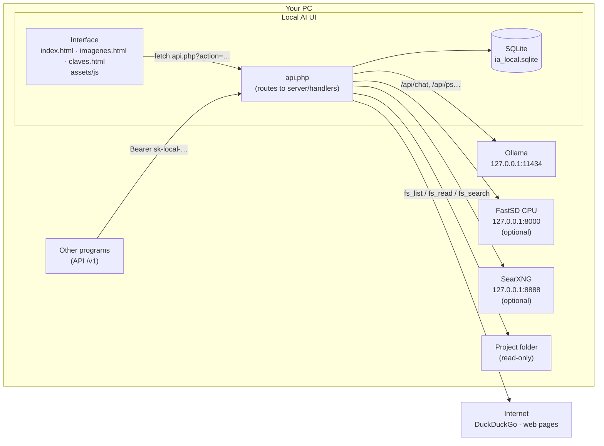
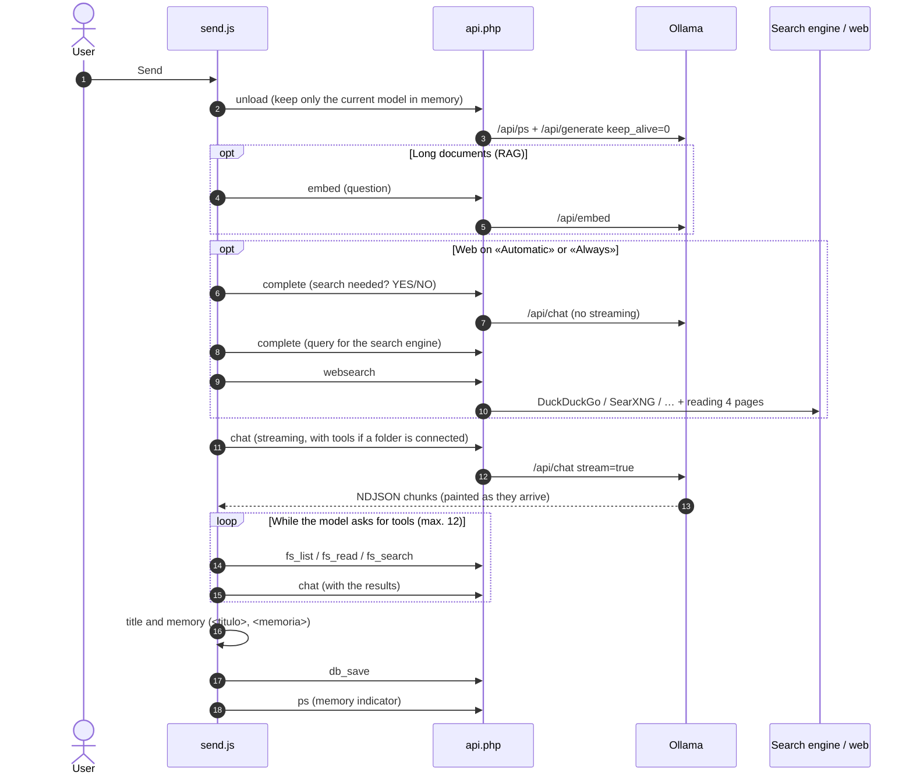

# Architecture

**English** · [Español](../arquitectura.md)

Local AI UI is a classic web application (HTML + framework-free JavaScript + PHP) that talks to **Ollama** on the same PC.
It runs in two ways with the same code:

| Mode | Web server | Window | Data |
| --- | --- | --- | --- |
| **XAMPP** (development) | XAMPP's Apache + PHP | Any browser | `data/ia_local.sqlite` and `galeria/` inside the project |
| **Desktop app** (`.exe`) | Portable PHP (`php -S`) + `desktop/router.php` | Electron | `%APPDATA%\Local AI UI\data` |

## Overview

The interface **never** talks to Ollama or the internet directly: everything goes through `api.php`. That lets the same page run
in the browser and in Electron, and keeps the security checks (paths, origin IP, keys) on the server.

## Layers

### 1. Interface (`index.html`, `imagenes.html`, `claves.html`, `assets/`)

- Three independent pages that share `assets/css/styles.css`, `assets/js/common.js`, `assets/js/icons.js` and the language engine.
- The chat is split into **classic scripts** (not ES modules) inside `assets/js/chat/`: they all share the global scope and
  **the load order in `index.html` matters** (a file can use another file's functions as long as they're called after everything has loaded).
- External libraries are copied into `assets/vendor/` (no CDN), so the interface works offline.
- Details: [frontend.md](frontend.md).

### 2. Server (`api.php`, `server/`)

- `api.php` is the only entry point. It reads `?action=` (or the OpenAI-style `/v1/...` path) and loads **one** file from `server/handlers/`.
- `server/lib/` holds shared code: database, HTTP/page reading and search engines.
- `server/config.php` reads the Ollama/FastSD addresses and the data folder (also from environment variables, which is how the desktop app sets them).
- Details: [backend.md](backend.md) · action reference: [api.md](api.md).

### 3. Data (SQLite)

A single `ia_local.sqlite` file in WAL mode with six tables: `chats`, `images`, `memories`, `settings`, `api_keys`, `gallery`.
Tables are created automatically on first use. Full schema in [backend.md](backend.md#database).

### 4. Desktop app (`desktop/`)

Electron starts portable PHP with `router.php` (which plays the role of Apache and the `.htaccess` files), waits for it to answer and
opens the interface in its window. It also starts Ollama if it's installed but closed, and frees the models' memory on exit.
Details: [desktop.md](desktop.md).

## The path of a message

What happens from pressing **Enviar** (Send) until the answer is saved (function `send()` in `assets/js/chat/send.js`):

Each optional step is explained in [features.md](features.md).

## Design decisions

| Decision | Reason |
| --- | --- |
| Framework-free PHP and bundler-free JS | The project started on XAMPP: copy the folder and open the browser. No build step. |
| One file per topic in `assets/js/chat/` | Small, easy-to-find files without build tools. |
| SQLite instead of MySQL | One file, no server: essential for the `.exe`. Old data can be imported with `server/tools/importar-mysql.php`. |
| Libraries in `assets/vendor/` | Work offline and keep the `.exe` independent of any CDN. |
| PHP's built-in server (`php -S`) in the `.exe` | Avoids bundling Apache. Trade-off: on Windows it handles one request at a time. |
| The AI doesn't write to the project folder | Local models make more mistakes; reading is useful and risk-free. |
| Text-based SEARCH/REPLACE edits | Work with any model (no *tool calling* needed) and save tokens compared to rewriting the file. |
