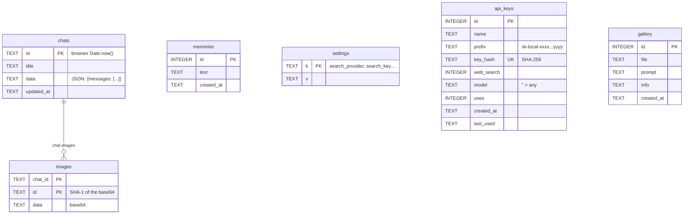

# Server (PHP)

**English** · [Español](../backend.md)

The whole server is PHP 8 with no Composer dependencies. Required extensions: **curl**, **pdo_sqlite**, **mbstring**,
**openssl** (HTTPS), **dom** (reading DuckDuckGo) and **fileinfo**. `pdo_mysql` is only needed for the importer.

```
api.php                     Entry point: routes each action to a handler
server/
├── .htaccess               Blocks browser access to server/ (Apache)
├── config.php              Ollama and FastSD addresses, data folder
├── lib/
│   ├── database.php        SQLite connection, table creation, helpers
│   ├── http.php            cURL requests, safe URLs, reading web pages
│   └── search.php          Search engines (DuckDuckGo, SearXNG, Ollama, Tavily, Google)
├── handlers/               One file per group of actions (see table)
└── tools/
    └── importar-mysql.php  Imports data from the MySQL version (command line only)
```

## `api.php`: routing

1. Defines `IA_LOCAL` and `ROOT_DIR`, removes the time limit (`set_time_limit(0)`) and loads `server/config.php`.
2. Reads the action from `?action=` (default: `chat`).
3. If the path is `api.php/v1/...` (OpenAI style), sets the action to `v1` and stores the path in `$ROUTE_PATH`
   (`PATH_INFO`, or extracted from `REQUEST_URI` if Apache doesn't provide it).
4. Checks that cURL is enabled, loads the three `server/lib/` libraries and picks the handler:

| Prefix / action | Handler | Purpose |
| --- | --- | --- |
| `db_*` | `chats.php` | Chat history, memory, search across chats |
| `gal_*` | `gallery.php` | Image gallery |
| `key_*` | `keys.php` | Local API keys and server search engine |
| `fs_*` | `files.php` | Project folder (read-only) |
| `models`, `check_updates`, `pull` | `models.php` | Model list, updates and downloads |
| `image`, `imagestatus`, `imagegen` | `images.php` | FastSD CPU |
| `websearch` | `websearch.php` | Web search for the chat |
| `v1` | `openai.php` | OpenAI-compatible API |
| anything else (`chat`, `complete`, `embed`, `ps`, `unload`) | `chat.php` | Conversation with Ollama |

Every handler starts with `if (!defined('IA_LOCAL')) { http_response_code(403); exit; }`: if someone opens the file directly in the
browser, nothing runs. Parameters and responses for each action are in [api.md](api.md).

## `server/config.php`

| Variable | Default | Environment variable that overrides it |
| --- | --- | --- |
| `$OLLAMA` | `http://127.0.0.1:11434` | `IA_LOCAL_OLLAMA` |
| `$FASTSD` | `http://127.0.0.1:8000` | `IA_LOCAL_FASTSD` |
| `$DATA_DIR` | `<project>/data` | `IA_LOCAL_DATA` |
| `$DB_FILE` | `$DATA_DIR/ia_local.sqlite` | — |
| `$GALLERY_DIR` | `<project>/galeria` (or `$DATA_DIR/galeria` when `IA_LOCAL_DATA` is set) | — |

`127.0.0.1` is used instead of `localhost` to avoid Windows IPv6 issues.
The desktop app sets `IA_LOCAL_DATA` and `IA_LOCAL_OLLAMA` when it starts PHP (see [desktop.md](desktop.md)).

## Libraries (`server/lib/`)

### `database.php`

| Function | What it does |
| --- | --- |
| `db()` | Returns the PDO connection (one per request). The first time it creates the data folder, an `.htaccess` that protects it, the SQLite file (WAL mode, `synchronous=NORMAL`, 10 s wait if another request is writing) and the tables. |
| `sql_ts($col)` | SQL expression that turns a stored date (UTC text) into Unix seconds, like MySQL's `UNIX_TIMESTAMP()`. |
| `chat_id($v)` | Sanitizes a chat id: only letters, digits, `_` and `-`. |
| `norm_model($m)` | Normalizes a model name: lowercase, and `:latest` when there's no tag (`qwen3` = `qwen3:latest`). |

### `http.php`

| Function | What it does |
| --- | --- |
| `http_req($url, $opts)` | Simple cURL request. Returns `[body, HTTP code, error]`. Default timeout: 30 s. |
| `safe_url($u)` | `true` only for `http(s)` URLs whose host resolves to a **public** IP (blocks localhost and private networks). |
| `page_date($html, $url)` | A page's publication date (`Y-m-d`): metadata (`article:published_time`, `datePublished`…), JSON-LD, `<time datetime>` or the URL itself (`/2026/09/24/`). |
| `scrape_page($url, $max = 2500, &$date)` | Downloads a page and returns its useful text. Follows redirects manually (re-checking each hop with `safe_url`), stops at 500 KB, strips scripts, menus, footers, forms and buttons, keeps the `<article>` or `<main>` if present and drops short lines without numbers (menus). Also returns the date. |

### `search.php`

| Function | What it does |
| --- | --- |
| `search_cfg($in)` | Search engine settings: what's stored in the `settings` table (`search_*`), overridden field by field by what the browser sends. |
| `web_search($q, $cfg)` | Searches with the chosen provider and returns `[['title','url','content','date'], …]`. Throws an `Exception` with a readable message on failure. |
| `ddg_search($q)` | DuckDuckGo without an API key: tries the «lite» version, then the HTML one, and a last retry after 0.7 s. Detects the captcha (`anomaly-modal`). |
| `ddg_parse_lite` / `ddg_parse_html` | Read the results with `DOMDocument` + XPath (link `a.result-link` / `a.result__a`, snippet `td.result-snippet` / `.result__snippet`). Ads are skipped. |
| `ddg_url($href)` | Extracts the real URL from `//duckduckgo.com/l/?uddg=…` redirect links. |
| `searx_search($q, $cfg)` | SearXNG: `GET /search?format=json`. Explains the 403 error (JSON disabled in its `settings.yml`). |
| `scrape_results($out, $cfg)` | When page reading is on (default), reads the first 4 pages with `scrape_page` (max. 12 s in total) and records their dates. |
| `web_rules($today)` | Instructions for the model: today's date, prefer the most recent source, don't present past events as upcoming, don't make things up, cite with `[n]`. |
| `web_context($results)` | Results + rules that the `/v1` API appends to the user's message. The chat builds its own in JavaScript (`send.js`) with the same format. |

## Handlers (`server/handlers/`)

| File | Summary |
| --- | --- |
| `chat.php` | `embed` (vectors for RAG), `ps`/`unload` (models in memory; embedding models are unloaded through `/api/embed` because they don't support `/api/generate`), `complete` (short answer without streaming, with configurable `num_ctx`, `temperature`, `num_predict` and `keep_alive`) and the **streaming chat**: forwards to Ollama's `/api/chat` and passes each NDJSON chunk to the browser (`flush()` per chunk; when the user presses Stop, `connection_aborted()` cuts the download). Accepts `tools` for the project folder. |
| `chats.php` | Chat CRUD. On save, base64 images (attached or generated) are moved to the `images` table (key: SHA-1) and the chat JSON stores `ref:<sha1>`; on load they're rebuilt. Images no longer in the chat are deleted. Also long-term memory and full-text search across chats (`LIKE` with `ESCAPE`). |
| `files.php` | Project folder, **read-only** and **only from 127.0.0.1/::1**. `fs_root` rejects drive roots and system folders; `fs_path` resolves with `realpath` and rejects anything outside the root (including `..` and symlinks). Skips `node_modules`, `vendor`, `.git`, build output and hidden folders; doesn't read binaries (null byte in the first 8 KB) or files over 2 MB. `fs_read` returns at most 400 numbered lines; `fs_search` is case-insensitive and, if the phrase isn't found, searches its individual words and ranks by matches. |
| `gallery.php` | Saves generated images in `$GALLERY_DIR` (name: SHA-1 + extension from the JPEG/PNG signature) and their metadata in `gallery`. |
| `images.php` | Bridge to FastSD CPU. `imagegen` supports OpenVINO, LCM and LCM-LoRA models (`lora:<base model>`). `image` is a simplified variant the interface no longer uses. |
| `keys.php` | API keys: generates `sk-local-<48 hex>` and **stores only its SHA-256**; the full key is returned only once. Each key can have web-search permission and an assigned model. Also stores the search engine settings used by the `/v1` API. |
| `models.php` | `models` forwards `/api/tags` and fills in **capabilities** (vision, tools, thinking) with `/api/show` in parallel (`curl_multi`), because some Ollama versions don't include them. `check_updates` compares the local digest with the registry's (`/v2/<repo>/manifests/<tag>`). `pull` streams the download progress. |
| `openai.php` | OpenAI-compatible API: `Bearer` authentication, assigned-model filter, optional web search (`"web_search": true` or `model+web`) and forwarding to Ollama's `/v1/chat/completions`, with and without streaming. |
| `websearch.php` | The chat's `websearch` action: `search_cfg` + `web_search`. |

## Database

SQLite file created by `db()`. Dates are stored as UTC text (`CURRENT_TIMESTAMP`).



**A chat's JSON** (`chats.data`) is `{"messages": [...]}`. Each message:

| Field | Type | Meaning |
| --- | --- | --- |
| `role` | `user` \| `assistant` \| `system` | The first one may be `{role:'system', sys:true, content, folder?}`: the chat's system prompt and the connected folder. |
| `content` | text | Markdown. AI messages may include code blocks and `edit` blocks. |
| `files` | list | Attachments: `{name, text}` or `{name, image}` (`ref:<sha1>` in the database); with RAG, `{name, chunks:[{t, v}]}`. |
| `thinking` | text | The model's reasoning (if any). |
| `model`, `stats` | | Model used and `{prompt, gen, tps}`. |
| `tools` | list | Project folder lookups: `{summary, error}`. |
| `mem` | list | Memories saved in that answer. |
| `gen`, `genImage`, `genPrompt` | | Image mode messages. |

## Security

| Measure | Where |
| --- | --- |
| Handlers don't run when opened directly | `IA_LOCAL` guard in every file |
| `server/` not reachable from the browser | `server/.htaccess` (Apache) and `desktop/router.php` |
| The database can't be downloaded | `.htaccess` created in the data folder; the router blocks `/data` |
| The app can't be loaded inside a frame (code panel preview) | `.htaccess` (`Sec-Fetch-Dest: iframe` → 403) and `router.php` |
| Project folder: read-only, local only, never outside the root | `files.php` |
| Web page reading never touches the local network | `safe_url()` on every redirect hop |
| API keys stored as hashes | `keys.php` / `openai.php` |
| AI HTML sanitized | DOMPurify in the browser |

**Important:** with XAMPP, Apache listens on all network interfaces by default. Anyone on your local network could open the page and
use the API. The desktop app only listens on `127.0.0.1`. Don't expose this server to the internet.

## `server/tools/importar-mysql.php`

Command-line script (`php importar-mysql.php [host] [user] [password] [database]`) that copies the tables of the MySQL version
(`chats`, `images`, `memories`, `settings`, `api_keys`, `gallery`) into SQLite with `INSERT OR REPLACE`, converts dates to UTC and
copies the files in `galeria/`. It only reads from MySQL. Launched by `desktop/importar-mysql.bat`.
