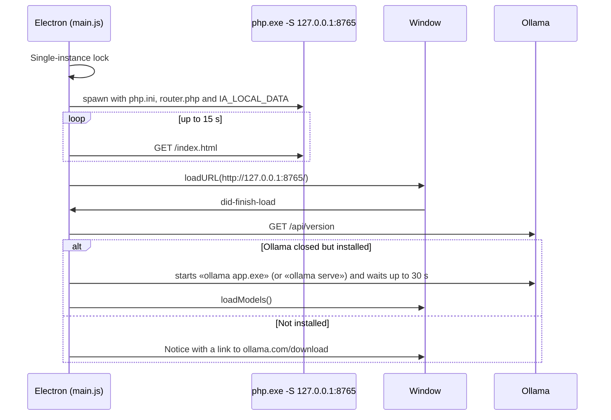

# Desktop app (`desktop/`)

**English** · [Español](../escritorio.md)

The `desktop/` folder turns the project into a Windows program that **doesn't need XAMPP**: it carries its own PHP and
opens the interface in an Electron window.

```
desktop/
├── package.json           Electron, electron-builder and the packaging configuration
├── main.js                Main process: starts PHP, opens the window, menus, Ollama
├── preload.js             Safe bridge to the page: prompt(), folder picker
├── prompt.html            Small window that replaces prompt() (Electron doesn't implement it)
├── prompt-preload.js      That small window's bridge
├── router.php             php -S router: plays the role of Apache and the .htaccess files
├── php.ini                Portable PHP configuration (extensions, limits, no buffering)
├── build/icon.png         App icon (512×512)
├── preparar-php.ps1       Downloads PHP 8.3 for Windows and cacert.pem
├── construir.bat          Builds the installer and the portable version
├── probar.bat             Opens the app without packaging (to test changes)
└── importar-mysql.bat     Brings in the data from the XAMPP/MySQL version
```

Script names are in Spanish: *construir* = build, *probar* = test, *preparar* = prepare, *importar* = import.

## How it starts



1. **Single copy:** if one is already open, it's brought to the front.
2. **PHP:** `php.exe` from `resources/php` (or `desktop/php` when not packaged) with:
   - `-c php.ini` and, with absolute paths, `extension_dir`, `curl.cainfo` and `openssl.cafile` (the program folder may contain spaces);
   - `-S 127.0.0.1:<port> -t <web> router.php`;
   - the environment variables `IA_LOCAL_DATA` (data folder) and `IA_LOCAL_OLLAMA`.
3. **Port:** 8765, fixed so the API URL doesn't change. If it's taken, a random free one is used.
   It can be changed with the `IA_LOCAL_PORT` environment variable.
4. **Log:** PHP's output goes to `%APPDATA%\Local AI UI\php.log`, which rotates past 5 MB. If PHP exits on its own, a notice appears.
5. **On exit:** every Ollama model is unloaded from memory (4 s at most) and PHP is stopped. Ollama stays open.

## Paths

| What | Not packaged (`probar.bat`) | Installed program |
| --- | --- | --- |
| Web (`index.html`, `api.php`, `server/`…) | project folder | `resources\web` |
| PHP | `desktop\php` | `resources\php` |
| `router.php`, `php.ini` | `desktop\` | `resources\` |
| Data (SQLite, gallery) | `%APPDATA%\Local AI UI\data` | same |
| PHP log | `%APPDATA%\Local AI UI\php.log` | same |

The **Archivo** (File) menu (shown with the Alt key) opens the data folder and the log, and copies the API URL.

## `router.php`

`php -S` doesn't read `.htaccess`, so the router reproduces its rules:

| Request | Response |
| --- | --- |
| Any page requested from a frame (`Sec-Fetch-Dest: iframe`) | 403 (the app is never loaded inside the preview) |
| `/server/…`, `/data/…`, `/desktop/…`, hidden files, paths with `..` | 403 |
| `/galeria/<file>` | The image from `IA_LOCAL_DATA/galeria` |
| `/api.php` and `/api.php/v1/…` | Runs `api.php` with `PATH_INFO` |
| Any other `.php` | 403 |
| Everything else | Static file |

## Window security

- `contextIsolation` on. The page only sees `window.iaDesktop` (`prompt`, `pickFolder`, `openDataFolder`).
- External links open in the system browser (`setWindowOpenHandler`, `will-navigate`). Only `about:blank` windows
  are allowed (PDF export).
- Frames (the code panel preview) can't navigate to any website (`will-frame-navigate`).
- PHP only listens on `127.0.0.1`: other computers on the network can't connect.

## Building

Requirements: Windows 10/11 x64 and [Node.js LTS](https://nodejs.org) (only for building).

```bat
desktop\construir.bat
```

1. Checks for Node.js.
2. If `desktop\php\php.exe` doesn't exist, runs `preparar-php.ps1`: looks up the latest 8.3 NTS x64 version in windows.php.net's
   `releases.json` (or in the folder listing if that fails), checks its SHA-256, unzips it and downloads `cacert.pem` from curl.se.
3. Copies the Visual C++ runtime (`vcruntime140.dll`, `vcruntime140_1.dll`, `msvcp140.dll`) next to `php.exe`, so it works
   on computers that don't have it installed.
4. `npm install` and `npm run dist` (`electron-builder --win nsis portable --x64`).

Output in `desktop\dist`:

| File | What it is |
| --- | --- |
| `Local AI UI-<version>-x64-nsis.exe` | Per-user installer (no administrator needed; lets you pick the folder; creates a shortcut) |
| `Local AI UI-<version>-portable.exe` | A single file that opens without installing |
| `win-unpacked\` | The uncompressed app (`Local AI UI.exe` + resources). It can be zipped and distributed that way. |

What goes into the package (`build.extraResources` in `package.json`): the whole project folder into `resources\web`
**except** `desktop/`, `data/`, `galeria/`, `searxng/`, `docs/`, `.git`, `*.sqlite*`, `limpiar.bat`, `.gitignore`, `README.md`,
`README.es.md` and `CITATION.cff`; plus `php/`, `router.php` and `php.ini`.

To change the program's version, edit `"version"` in `desktop/package.json`.

### Build problems

| Symptom | Fix |
| --- | --- |
| Only `win-unpacked` appears, no installer. In the window: «Cannot create symbolic link… A required privilege is not held by the client» | Turn on Windows **Developer Mode** (Settings → System → For developers) or run `construir.bat` as administrator. |
| «Falta Node.js» (Node.js missing) | Install Node.js LTS and open a new console. |
| Error downloading PHP | Download the «VS16 x64 Non Thread Safe» zip from windows.php.net by hand and unzip it into `desktop\php`. |
| The app opens and says PHP closed | Check `%APPDATA%\Local AI UI\php.log`. |
| «Windows protected your PC» when opening the program | The program isn't signed: «More info» → «Run anyway». |

## Testing without packaging

`desktop\probar.bat` downloads PHP and Electron if needed and runs `npm start`. Web changes show up with **Ctrl+R**;
changes to `main.js` require closing and reopening.

## Importing data from the MySQL version

Start MySQL in XAMPP and run `desktop\importar-mysql.bat` (optional: `importar-mysql.bat host user password database`).
It copies chats, images, memory, search engine settings, API keys and the gallery into `%APPDATA%\Local AI UI\data`. It doesn't delete anything from MySQL.
