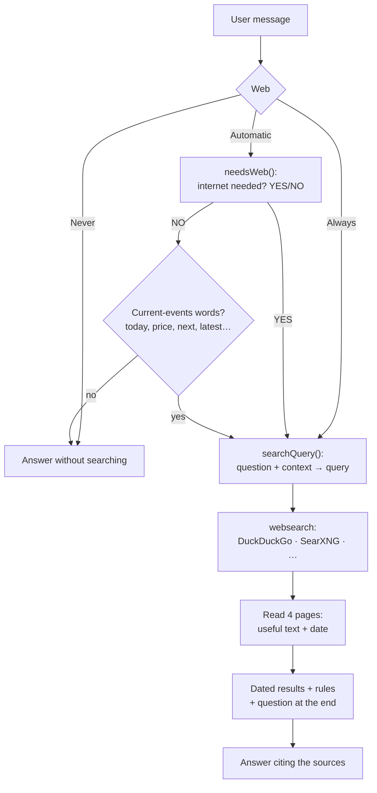
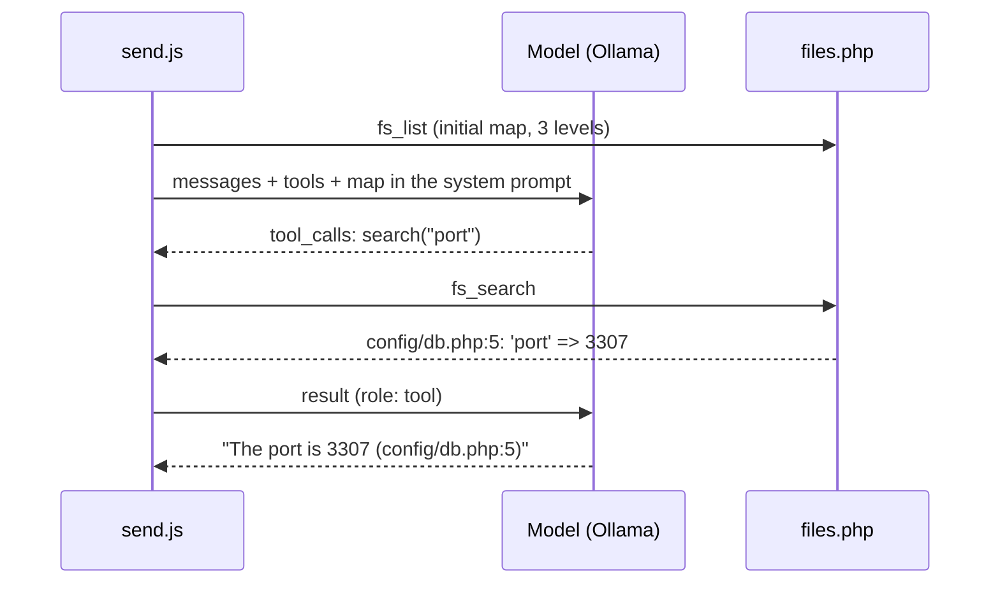

# How each feature works

**English** · [Español](../funciones.md)

An inside look at the main features: which files are involved, in what order, and why they're built that way.

- [Conversation and streaming](#conversation-and-streaming)
- [Automatic web search](#automatic-web-search)
- [Code panel and edits](#code-panel-and-edits)
- [Project folder](#project-folder)
- [Models in memory](#models-in-memory)
- [Attachments and RAG](#attachments-and-rag)
- [Long-term memory and titles](#long-term-memory-and-titles)
- [Image mode](#image-mode)
- [Other utilities](#other-utilities)

---

## Conversation and streaming

**Files:** `send.js`, `messages.js`, `models.js`, `state.js`, `server/handlers/chat.php`.

1. `send()` adds the user's message and an empty answer to the chat, and creates the `AbortController` (`controller`).
   The **Enviar** (Send) button turns into **Detener** (Stop).
2. It picks the model with `modelFor(c)`: if the chat has images and a **vision model** is configured, it uses that one; otherwise, the selector's.
3. It builds the message list for Ollama: attachment text is appended to the message (`--- Archivo: x ---`), images go in
   `images` (only if the model has vision) and image mode messages are left out.
4. The system prompt is made of: the chat's own prompt, the memory, the web search rules, the chat's code files, the
   project folder and, in the first message, the title request.
5. `streamChat()` does `POST api.php` and reads the NDJSON chunk by chunk: `content` and `thinking` accumulate and the bubble is repainted with
   `paint()` on every chunk; the last one carries the stats (tokens and tokens/s), which feed the context counter.
6. When done: the title and memory are extracted, the chat is saved and the memory indicator is refreshed.

**Reasoning («think»).** Reasoning mode sends `think: true` and the other modes `false`, but only to models that support it.
Since Ollama doesn't always report that capability, `models.js` **learns**: if `thinking` arrives, the model is added to `knownThinking`;
if Ollama rejects the parameter, it's added to `noThinkModels` and the answer is retried without it. The **Respuesta rápida** (Quick answer)
button aborts the answer while it's reasoning and retries it with `think: false`.

**Context.** Above 85 % of the context, a warning appears with **Resumir y continuar** (Summarize and continue): the model summarizes the
conversation and the chat is replaced by that summary.

---

## Automatic web search

**Files:** `send.js` (decision, query, format), `settings.js`, `server/handlers/websearch.php`, `server/lib/search.php`, `server/lib/http.php`.



1. **Mode** («Web» selector next to the model): `auto` (default), `always` or `never`.
2. **Decision** (`needsWeb`, only in `auto`): a short question to the chat's own model (already in memory), without reasoning,
   `temperature 0`, at most 8 tokens. The prompt explains what needs the internet and what doesn't, includes examples and the rule
   «when in doubt, YES». If the chat has code files, a connected folder or attachments, it's told that questions about them don't need the internet.
   **Safety net:** if the model says NO but the message contains current-events words (`CURRENT_RE`: hoy, precio, próximo,
   actual, último, noticias — today, price, next, current, latest, news — a recent year…), it searches anyway, unless it's an order to create
   or change something («escribe…», «traduce…», «cambia…» — write, translate, change). The word lists are in Spanish and English.
   Tested with Qwen3 4B: 16 out of 16 correct on varied questions.
3. **Query** (`searchQuery`): the model turns the question and the chat's last 4 turns into a search of at most 12 words
   (`«and what time is it?»` → `Colombia vs Chile match time November 13 2026`).
4. **Search** (`web_search` in PHP): DuckDuckGo by default, no API key. Reads the «lite» version, then the HTML one, and retries once.
   Alternatives: a local SearXNG, or Ollama, Tavily and Google with an API key.
5. **Page reading** (`scrape_results`): the first 4, in 12 s at most. Only the `<article>`/`<main>`, without menus or buttons,
   2,500 characters per page, plus its **publication date**.
6. **Format for the model** (designed for small models): first the numbered results with their date, then the rules
   (`webRules`: today is…, prefer the most recent, what already happened isn't «upcoming», don't make things up, cite with [n]) and finally the question.
   The rules also go in the system prompt.
7. The answer starts with the list of **sources consulted** (links with their date). `stripSources()` removes it when that message is
   used as context for the next search.

---

## Code panel and edits

**Files:** `code-panel.js` (cards, panel, preview), `files.js` (versions and edits), `messages.js` (Markdown renderer).

### Cards and panel

- An AI code block with **12 lines or more** (`CODE_MIN_LINES`) is painted as a **file card** instead of inline.
- The name is taken from the block's info string (` ```python main.py`, ` ```js:app.js`) or from a comment on the first line
  (`// archivo: app.js` or `// file: app.js`). If there's none, a typical one for the language is used (`index.html`, `main.py`, `script.js`…), so two
  unnamed HTML blocks are treated as the same file.
- Opening a card shows the code in the side panel with line numbers and copy and download buttons. HTML/SVG
  have a **preview**. The panel width can be dragged and is remembered. While the AI writes, the panel opens by itself and follows the
  file live.

### Versions

`chatFiles(c, upto)` walks the AI's messages and rebuilds the files: every long block, or one with the name of an existing file,
is a **new version**; every `edit` block applies changes to the previous version. The renderer uses the state before the message
(`mdFiles`) to number the cards («v2 · 3 cambios» — v2 · 3 changes).

### Edit format

When the chat already has files, the model receives the **current version** of each one in the system prompt (the most recent ones,
as long as they fit in 45 % of the context) and these instructions:

````text
```edit index.html
<<<<<<< BUSCAR
<h1>Old title</h1>
=======
<h1>New title</h1>
>>>>>>> REEMPLAZAR
```
````

`BUSCAR` and `REEMPLAZAR` are Spanish for SEARCH and REPLACE; the markers are literal and are the same whatever the interface language.

- `parseEdits()` only takes complete changes (during streaming, the last one may be half-written: the card says «editando…» — editing).
- `applyEdits()` first looks for an **exact** match. If there's none, it compares line by line ignoring leading and trailing
  whitespace (models often lose indentation) and keeps the original indentation. An empty BUSCAR appends at the end.
  A change that doesn't fit doesn't break the file: it's counted as **«sin aplicar»** (not applied).
- `mergeEdits()` joins several consecutive `edit` blocks for the same file into a single version, because some models put one change per block.
- In the history sent to the model, the code of old versions is replaced by a reference
  (`[Archivo «index.html» versión 1: su contenido actual está en las instrucciones del sistema]` — its current content is in the system instructions).
  That way versions aren't repeated and context isn't wasted.
- Tested with Qwen3 4B: it answered with only the changes (the two lines to touch) and they were applied correctly.

### File list

The files button in the header (with its count) lists the **latest version** of each of the chat's files: open in the panel, download,
or **Descargar todo (.zip)** (Download all) with JSZip.

### Isolated preview

The preview is an `<iframe sandbox>` with `srcdoc`. Without protection, a link such as `href="#"` or `contacto.html` would navigate to the
app itself inside the panel. That's why there are three layers:

1. A **guard** injected at the start of the document (`previewGuard`): `#anchor` scrolls inside the page, `http(s)` opens
   in the browser, other links and forms show a notice.
2. If the page navigates anyway (for example with `location.href`), the `load` event detects it and the preview is reloaded
   (at most 3 times in 5 s).
3. The server doesn't serve the app inside a frame (`Sec-Fetch-Dest: iframe` → 403) and Electron blocks all web navigation in frames.

---

## Project folder

**Files:** `folder.js`, `send.js` (tool loop), `server/handlers/files.php`, `desktop/main.js` (folder picker).



- The folder button next to the paperclip connects a folder **to the chat**. In the desktop app, the Windows picker is used
  (`iaDesktop.pickFolder` → `dialog.showOpenDialog`); in the browser, you type the path. It's saved with the chat
  (in the special `sys` message).
- Requires a model with the **tools** capability (the selector shows «herramientas» / «tools»). If it doesn't have it, the bar warns about it and the
  chat answers without tools.
- Tools (`FOLDER_TOOLS`): `list_files(path, depth)`, `read_file(path, start_line, end_line)` and `search(query, path)`.
- **Loop:** while the model asks for tools, they're run (`runTool` → `fs_*`), logged in the bubble («Leyó…», «Buscó…» — Read…, Searched…)
  and returned to it as `role: tool` messages. At most 12 rounds per answer.
- **Help for small models** (added after testing with Qwen3 4B, which at first searched for whole sentences and gave up):
  the file map goes in the prompt from the start, the instructions ask it to search for words from the code rather than sentences,
  and `fs_search` searches the individual words when the phrase isn't found.
- The context goes up to at least 16k tokens (`FOLDER_CTX`) when there's a folder.
- Security limits: see [backend.md](backend.md#handlers-serverhandlers).

---

## Models in memory

**Files:** `ram.js`, `send.js`, `generation.js`, `server/handlers/chat.php` (`ps`, `unload`), `desktop/main.js`.

- **«Mantener solo un modelo en memoria»** (Keep only one model in memory, on by default): before every answer, and when the selector changes, `unloadOthers()`
  asks the server to unload every model except the current one and the embedding model. That way, when you switch AI, the previous one frees RAM and VRAM.
- In **image mode**, the text model is unloaded once the prompt is done (`keep_alive: 0`) to leave the memory to FastSD.
- The **header** shows which model is loaded and how much it takes (on hover, how much is in GPU and how much in RAM). It's updated
  after every answer and every 30 s. The eject button unloads them all.
- **When the desktop app closes**, `main.js` unloads all models (4 s at most) before quitting.
- **When the desktop app opens**, if Ollama doesn't answer but is installed (`%LOCALAPPDATA%\Programs\Ollama`), it's started automatically
  (`ollama app.exe`, or `ollama serve`) and the app waits up to 30 s.

---

## Attachments and RAG

**Files:** `attachments.js`, `file-reader.js`, `rag.js`, `events.js`.

- Attach with the paperclip, by dragging onto the footer or by pasting (Ctrl+V, screenshots included).
- **Images:** scaled down to 1280 px at most and sent as base64 JPEG (only a vision model uses them).
- **PDF:** text is extracted with pdf.js. If it has almost no text (scanned PDF), each page is turned into an image for a vision
  model, up to the «Páginas de PDF escaneado» (Scanned PDF pages) limit.
- **Other formats** (`file-reader.js`): text and code, docx, pptx, odt, odp, epub, zip, xlsx/xls/ods (as CSV per sheet), ipynb,
  eml, rtf and .gz. Detects binaries and UTF-16. Limit: 50 MB per file and 200,000 characters of text.
- **RAG** (optional): if a document exceeds 8,000 characters, it's split into chunks (1,000 characters with overlap), their
  embeddings are computed with Ollama (`nomic-embed-text` by default) and stored with the message. Each question adds the 5 most
  similar chunks (cosine similarity) instead of the whole document.

---

## Long-term memory and titles

**File:** `memory.js`.

- With memory on, the system prompt includes what's already known about the user (the last 60 memories) and asks that, if the user reveals
  something lasting, the model append it at the end as `<memoria>fact</memoria>`. Those tags are hidden while it writes, stored in the
  `memories` table, and the answer shows «Guardado en memoria: …» (Saved to memory). Memories can be viewed, added and deleted in Settings.
- The first message of a chat asks for a 3-to-6-word `<titulo>…</titulo>` that becomes the chat's name.

---

## Image mode

**Files:** `generation.js`, `events.js`, `server/handlers/images.php`.

The image button turns the mode on: the message is turned into an image with FastSD CPU. If «Traducir y mejorar el prompt
con la IA» (Translate and improve the prompt with the AI) is on, the text model translates it into English and enriches it first.
Each image model's steps come from `IMG_PRESETS`.
The **image console** (`imagenes.html`) offers every parameter (negative prompt, steps, guidance, size, count, seed,
OpenVINO, LCM-LoRA) and saves each image to the gallery.

---

## Other utilities

| Feature | Where |
| --- | --- |
| Edit a message and resend it (discards what came after) | `messages.js` → `startEdit` |
| Regenerate the last answer | `actions.js` → `regenerate` |
| Export the chat to Markdown or PDF (print window) | `actions.js` |
| Search all chats (title and content) | `actions.js` + `db_search` |
| Rename and delete chats | `actions.js`, `chats.js` |
| Shortcuts: Alt+N new chat · Ctrl+B sidebar · Ctrl+, settings · Ctrl+K search · Esc closes the panel | `actions.js`, `code-panel.js` |
| Model manager: check for updates and download with progress | `models.js` + `check_updates`, `pull` |
| API keys console: create, assign a model, revoke, configure the server search engine and test the API | `claves.html`, `pages/claves.js` |
