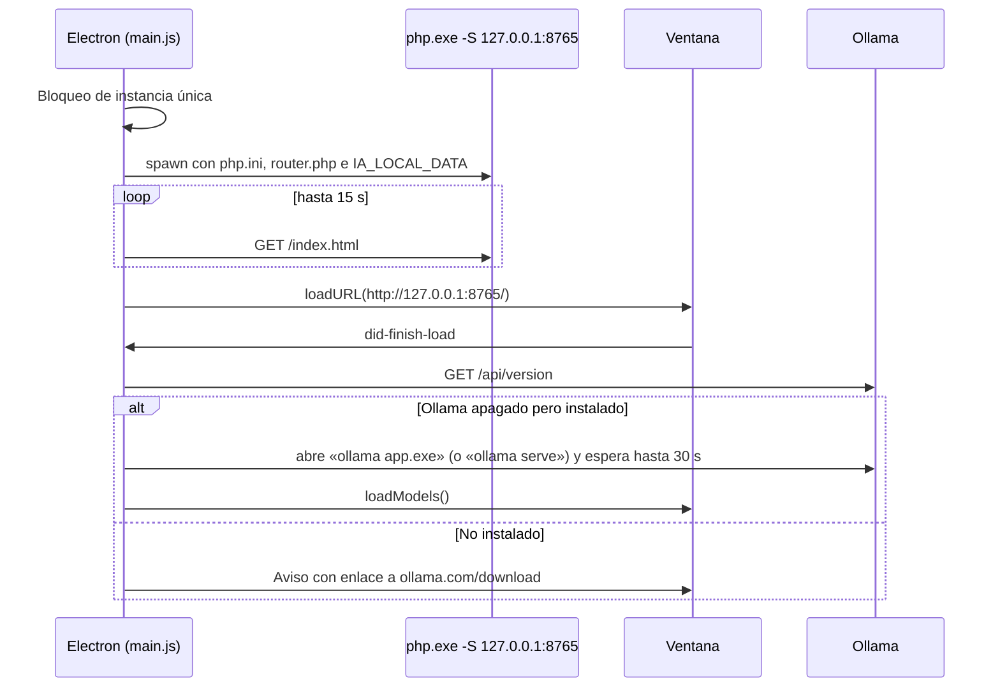

# App de escritorio (`desktop/`)

La carpeta `desktop/` convierte el proyecto en un programa de Windows que **no necesita XAMPP**: lleva dentro su propio PHP y
abre la interfaz en una ventana de Electron.

```
desktop/
├── package.json           Electron, electron-builder y la configuración del empaquetado
├── main.js                Proceso principal: arranca PHP, abre la ventana, menús, Ollama
├── preload.js             Puente seguro con la página: prompt(), selector de carpetas
├── prompt.html            Ventanita que sustituye a prompt() (Electron no lo implementa)
├── prompt-preload.js      Puente de esa ventanita
├── router.php             Enrutador de php -S: hace el papel de Apache y los .htaccess
├── php.ini                Configuración del PHP portátil (extensiones, límites, sin búfer)
├── build/icon.png         Icono de la app (512×512)
├── preparar-php.ps1       Descarga PHP 8.3 para Windows y cacert.pem
├── construir.bat          Crea el instalador y la versión portátil
├── probar.bat             Abre la app sin empaquetar (para probar cambios)
└── importar-mysql.bat     Trae los datos de la versión con XAMPP/MySQL
```

## Cómo arranca



1. **Una sola copia:** si ya hay una abierta, se trae al frente.
2. **PHP:** `php.exe` de `resources/php` (o `desktop/php` sin empaquetar) con:
   - `-c php.ini` y, con rutas absolutas, `extension_dir`, `curl.cainfo` y `openssl.cafile` (la carpeta del programa puede tener espacios);
   - `-S 127.0.0.1:<puerto> -t <web> router.php`;
   - variables de entorno `IA_LOCAL_DATA` (carpeta de datos) e `IA_LOCAL_OLLAMA`.
3. **Puerto:** 8765, fijo para que la URL de la API no cambie. Si está ocupado se usa uno libre al azar.
   Se cambia con la variable de entorno `IA_LOCAL_PORT`.
4. **Registro:** la salida de PHP va a `%APPDATA%\Local AI UI\php.log`, que rota al pasar de 5 MB. Si PHP se cierra solo, aparece un aviso.
5. **Al salir:** se descargan de memoria todos los modelos de Ollama (como mucho 4 s) y se detiene PHP. Ollama sigue abierto.

## Rutas

| Qué | Sin empaquetar (`probar.bat`) | Programa instalado |
| --- | --- | --- |
| Web (`index.html`, `api.php`, `server/`…) | carpeta del proyecto | `resources\web` |
| PHP | `desktop\php` | `resources\php` |
| `router.php`, `php.ini` | `desktop\` | `resources\` |
| Datos (SQLite, galería) | `%APPDATA%\Local AI UI\data` | igual |
| Registro de PHP | `%APPDATA%\Local AI UI\php.log` | igual |

El menú **Archivo** (aparece con la tecla Alt) abre la carpeta de datos y el registro, y copia la URL de la API.

## `router.php`

`php -S` no lee `.htaccess`, así que el enrutador reproduce sus reglas:

| Petición | Respuesta |
| --- | --- |
| Cualquier página pedida desde un marco (`Sec-Fetch-Dest: iframe`) | 403 (la app nunca se carga dentro de la vista previa) |
| `/server/…`, `/data/…`, `/desktop/…`, archivos ocultos, rutas con `..` | 403 |
| `/galeria/<archivo>` | La imagen desde `IA_LOCAL_DATA/galeria` |
| `/api.php` y `/api.php/v1/…` | Ejecuta `api.php` con `PATH_INFO` |
| Otro `.php` | 403 |
| Lo demás | Archivo estático |

## Seguridad de la ventana

- `contextIsolation` activado. La página solo ve `window.iaDesktop` (`prompt`, `pickFolder`, `openDataFolder`).
- Los enlaces externos se abren en el navegador del sistema (`setWindowOpenHandler`, `will-navigate`). Solo se permiten ventanas
  `about:blank` (la exportación a PDF).
- Los marcos (vista previa del panel de código) no pueden navegar a ninguna web (`will-frame-navigate`).
- PHP solo escucha en `127.0.0.1`: otros equipos de la red no pueden conectarse.

## Construir

Requisitos: Windows 10/11 x64 y [Node.js LTS](https://nodejs.org) (solo para construir).

```bat
desktop\construir.bat
```

1. Comprueba Node.js.
2. Si no existe `desktop\php\php.exe`, ejecuta `preparar-php.ps1`: busca la última versión 8.3 NTS x64 en `releases.json` de
   windows.php.net (o en el listado de la carpeta si falla), comprueba su SHA-256, la descomprime y descarga `cacert.pem` de curl.se.
3. Copia el runtime de Visual C++ (`vcruntime140.dll`, `vcruntime140_1.dll`, `msvcp140.dll`) junto a `php.exe`, para que funcione
   en equipos que no lo tengan instalado.
4. `npm install` y `npm run dist` (`electron-builder --win nsis portable --x64`).

Resultado en `desktop\dist`:

| Archivo | Qué es |
| --- | --- |
| `Local AI UI-<versión>-x64-nsis.exe` | Instalador por usuario (no pide administrador; permite elegir carpeta; crea acceso directo) |
| `Local AI UI-<versión>-portable.exe` | Un solo archivo que se abre sin instalar |
| `win-unpacked\` | La app sin comprimir (`Local AI UI.exe` + recursos). Se puede comprimir en .zip y distribuir así. |

Qué entra en el paquete (`build.extraResources` de `package.json`): toda la carpeta del proyecto en `resources\web`
**excepto** `desktop/`, `data/`, `galeria/`, `searxng/`, `docs/`, `.git`, `*.sqlite*`, `limpiar.bat`, `.gitignore` y `README.md`;
más `php/`, `router.php` y `php.ini`.

Para cambiar la versión del programa, edita `"version"` en `desktop/package.json`.

### Problemas al construir

| Síntoma | Solución |
| --- | --- |
| Solo aparece `win-unpacked`, sin instalador. En la ventana: «Cannot create symbolic link… A required privilege is not held by the client» | Activa el **Modo de desarrollador** de Windows (Configuración → Sistema → Para desarrolladores) o ejecuta `construir.bat` como administrador. |
| «Falta Node.js» | Instala Node.js LTS y abre una consola nueva. |
| Error al descargar PHP | Descarga a mano el zip «VS16 x64 Non Thread Safe» de windows.php.net y descomprímelo en `desktop\php`. |
| La app abre y dice que PHP se cerró | Mira `%APPDATA%\Local AI UI\php.log`. |
| «Windows protegió su PC» al abrir el programa | El programa no está firmado: «Más información» → «Ejecutar de todas formas». |

## Probar sin empaquetar

`desktop\probar.bat` descarga PHP y Electron si hace falta y ejecuta `npm start`. Los cambios en la web se ven con **Ctrl+R**;
los cambios en `main.js` requieren cerrar y volver a abrir.

## Importar datos de la versión con MySQL

Inicia MySQL en XAMPP y ejecuta `desktop\importar-mysql.bat` (opcional: `importar-mysql.bat host usuario contraseña base`).
Copia chats, imágenes, memoria, ajustes del buscador, API keys y galería a `%APPDATA%\Local AI UI\data`. No borra nada de MySQL.
