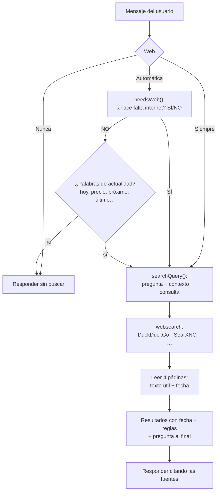
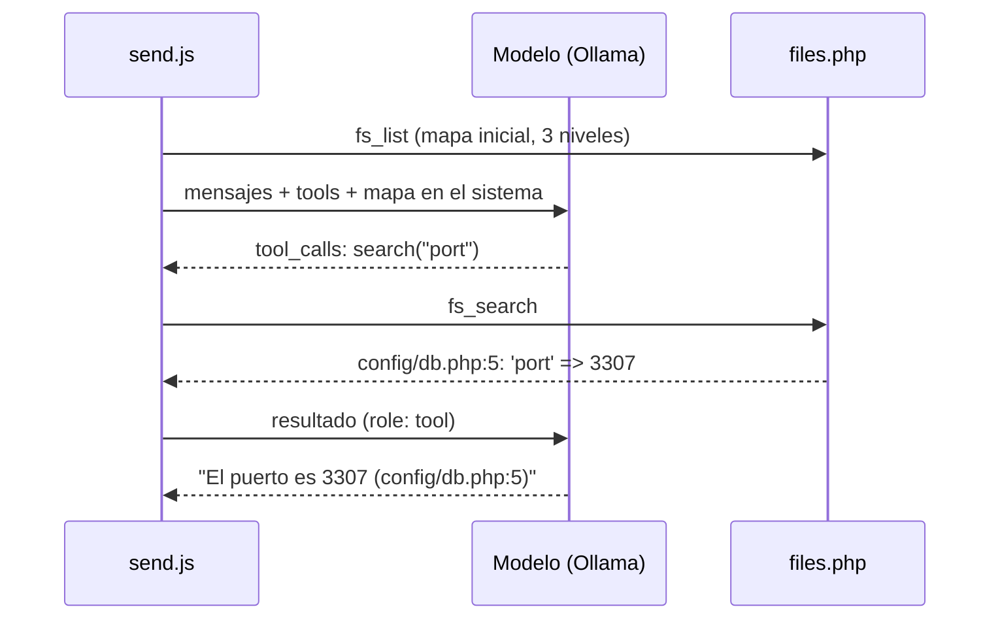

# Cómo funciona cada función

Explicación por dentro de las funciones principales: qué archivos intervienen, en qué orden y por qué están hechas así.

- [Conversación y streaming](#conversación-y-streaming)
- [Búsqueda web automática](#búsqueda-web-automática)
- [Panel de código y ediciones](#panel-de-código-y-ediciones)
- [Carpeta del proyecto](#carpeta-del-proyecto)
- [Modelos en memoria](#modelos-en-memoria)
- [Adjuntos y RAG](#adjuntos-y-rag)
- [Memoria a largo plazo y títulos](#memoria-a-largo-plazo-y-títulos)
- [Modo imagen](#modo-imagen)
- [Otras utilidades](#otras-utilidades)

---

## Conversación y streaming

**Archivos:** `send.js`, `messages.js`, `models.js`, `state.js`, `server/handlers/chat.php`.

1. `send()` añade el mensaje del usuario y una respuesta vacía al chat, y crea el `AbortController` (`controller`).
   El botón **Enviar** pasa a **Detener**.
2. Elige el modelo con `modelFor(c)`: si el chat tiene imágenes y hay un **modelo de visión** configurado, usa ese; si no, el del selector.
3. Construye la lista de mensajes para Ollama: el texto de los adjuntos se añade al mensaje (`--- Archivo: x ---`), las imágenes van
   en `images` (solo si el modelo tiene visión) y los mensajes del modo imagen se omiten.
4. El prompt de sistema se forma con: el del chat, la memoria, las reglas de la búsqueda web, los archivos de código del chat, la
   carpeta del proyecto y, en el primer mensaje, la petición de título.
5. `streamChat()` hace `POST api.php` y lee el NDJSON trozo a trozo: `content` y `thinking` se acumulan y la burbuja se repinta con
   `paint()` en cada trozo; el último trae las estadísticas (tokens y tokens/s), que alimentan el contador de contexto.
6. Al terminar: se extraen el título y la memoria, se guarda el chat y se refresca el indicador de memoria.

**Razonamiento («think»).** El modo Razonamiento envía `think: true` y los demás `false`, pero solo a modelos que lo admiten.
Como Ollama no siempre informa de esa capacidad, `models.js` **aprende**: si llega `thinking`, el modelo se apunta en `knownThinking`;
si Ollama rechaza el parámetro, se apunta en `noThinkModels` y la respuesta se repite sin él. El botón **Respuesta rápida** aborta
la respuesta mientras razona y la repite con `think: false`.

**Contexto.** Por encima del 85 % del contexto aparece el aviso con **Resumir y continuar**: el modelo resume la conversación y el
chat se reemplaza por ese resumen.

---

## Búsqueda web automática

**Archivos:** `send.js` (decisión, consulta, formato), `settings.js`, `server/handlers/websearch.php`, `server/lib/search.php`, `server/lib/http.php`.



1. **Modo** (selector «Web» junto al modelo): `auto` (por defecto), `always` o `never`.
2. **Decisión** (`needsWeb`, solo en `auto`): pregunta corta al mismo modelo del chat (ya está en memoria), sin razonamiento,
   `temperature 0`, máximo 8 tokens. El prompt explica qué pide internet y qué no, incluye ejemplos y la regla «ante la duda, SÍ».
   Si en el chat hay archivos de código, una carpeta conectada o adjuntos, se le indica que las preguntas sobre ellos no necesitan internet.
   **Red de seguridad:** si el modelo dice NO pero el mensaje contiene palabras de actualidad (`CURRENT_RE`: hoy, precio, próximo,
   actual, último, noticias, un año reciente…), se busca igual, salvo que sea una orden de crear o cambiar algo («escribe…», «traduce…», «cambia…»).
   Probado con Qwen3 4B: 16 de 16 aciertos en preguntas variadas.
3. **Consulta** (`searchQuery`): el modelo convierte la pregunta y las últimas 4 intervenciones del chat en una búsqueda de 12 palabras
   como mucho (`«¿y a qué hora es?»` → `hora del partido Colombia vs Chile 13 noviembre 2026`).
4. **Búsqueda** (`web_search` en PHP): DuckDuckGo por defecto, sin API key. Lee la versión «lite», luego la HTML y reintenta una vez.
   Alternativas: SearXNG local, o Ollama, Tavily y Google con API key.
5. **Lectura de páginas** (`scrape_results`): las 4 primeras, en 12 s como máximo. Solo el `<article>`/`<main>`, sin menús ni botones,
   2.500 caracteres por página, y su **fecha de publicación**.
6. **Formato para el modelo** (pensado para modelos pequeños): primero los resultados numerados con su fecha, luego las reglas
   (`webRules`: hoy es…, prioriza lo más reciente, lo que ya pasó no es «próximo», no inventes, cita con [n]) y al final la pregunta.
   Las reglas también van en el prompt de sistema.
7. La respuesta empieza con la lista de **fuentes consultadas** (enlaces con su fecha). `stripSources()` la quita al usar ese mensaje
   como contexto para la siguiente búsqueda.

---

## Panel de código y ediciones

**Archivos:** `code-panel.js` (tarjetas, panel, vista previa), `files.js` (versiones y ediciones), `messages.js` (renderer de Markdown).

### Tarjetas y panel

- Un bloque de código de la IA con **12 líneas o más** (`CODE_MIN_LINES`) se pinta como una **tarjeta de archivo** en vez de en línea.
- El nombre se toma de la info del bloque (` ```python main.py`, ` ```js:app.js`) o de un comentario en la primera línea
  (`// archivo: app.js`). Si no hay, se usa uno típico del lenguaje (`index.html`, `main.py`, `script.js`…), así que dos HTML
  sin nombre se consideran el mismo archivo.
- Al abrir una tarjeta, el panel lateral muestra el código con números de línea y botones de copiar y descargar. Para HTML/SVG
  hay **vista previa**. El ancho del panel se arrastra y se recuerda. Mientras la IA escribe, el panel se abre solo y sigue el
  archivo en directo.

### Versiones

`chatFiles(c, upto)` recorre los mensajes de la IA y reconstruye los archivos: cada bloque largo o con el nombre de un archivo existente
es una **versión nueva**; cada bloque `edit` aplica cambios a la versión anterior. El renderer usa el estado previo al mensaje
(`mdFiles`) para numerar las tarjetas («v2 · 3 cambios»).

### Formato de edición

Cuando el chat ya tiene archivos, el modelo recibe en el prompt de sistema la **versión actual** de cada uno (los más recientes,
mientras quepan en el 45 % del contexto) y estas instrucciones:

````text
```edit index.html
<<<<<<< BUSCAR
<h1>Título viejo</h1>
=======
<h1>Título nuevo</h1>
>>>>>>> REEMPLAZAR
```
````

- `parseEdits()` solo toma los cambios completos (durante el streaming, el último puede estar a medias: la tarjeta dice «editando…»).
- `applyEdits()` busca primero la coincidencia **exacta**. Si no la hay, compara línea a línea ignorando los espacios del principio y
  del final (los modelos suelen perder la sangría) y conserva la sangría original. Un BUSCAR vacío añade al final.
  Un cambio que no encaja no rompe el archivo: se cuenta como **«sin aplicar»**.
- `mergeEdits()` une varios bloques `edit` seguidos del mismo archivo en una sola versión, porque algunos modelos ponen un cambio por bloque.
- En el historial que se manda al modelo, el código de las versiones antiguas se sustituye por una referencia
  (`[Archivo «index.html» versión 1: su contenido actual está en las instrucciones del sistema]`). Así no se repiten versiones ni se gasta contexto.
- Probado con Qwen3 4B: respondió solo con los cambios (las dos líneas a tocar) y se aplicaron bien.

### Lista de archivos

El botón de archivos de la cabecera (con su número) lista la **última versión** de cada archivo del chat: abrir en el panel, descargar,
o **Descargar todo (.zip)** con JSZip.

### Vista previa aislada

La vista previa es un `<iframe sandbox>` con `srcdoc`. Sin protección, un enlace como `href="#"` o `contacto.html` navegaría a la
propia app dentro del panel. Por eso hay tres capas:

1. **Guardián** inyectado al principio del documento (`previewGuard`): `#ancla` se desplaza dentro de la página, `http(s)` se abre
   en el navegador, el resto de enlaces y los formularios muestran un aviso.
2. Si aun así la página navega (por ejemplo con `location.href`), el evento `load` lo detecta y se recarga la vista previa
   (como mucho 3 veces en 5 s).
3. El servidor no sirve la app dentro de un marco (`Sec-Fetch-Dest: iframe` → 403) y Electron bloquea toda navegación web de los marcos.

---

## Carpeta del proyecto

**Archivos:** `folder.js`, `send.js` (bucle de herramientas), `server/handlers/files.php`, `desktop/main.js` (selector de carpetas).



- El botón de carpeta junto al clip conecta una carpeta **al chat**. En la app de escritorio se usa el selector de Windows
  (`iaDesktop.pickFolder` → `dialog.showOpenDialog`); en el navegador, se escribe la ruta. Queda guardada con el chat
  (en el mensaje especial `sys`).
- Requiere un modelo con la capacidad **tools** (en el selector aparece «herramientas»). Si no la tiene, la barra lo avisa y el
  chat responde sin herramientas.
- Herramientas (`FOLDER_TOOLS`): `list_files(path, depth)`, `read_file(path, start_line, end_line)` y `search(query, path)`.
- **Bucle:** mientras el modelo pida herramientas, se ejecutan (`runTool` → `fs_*`), se registran en la burbuja («Leyó…», «Buscó…»)
  y se le devuelven como mensajes `role: tool`. Como mucho 12 rondas por respuesta.
- **Ayudas para modelos pequeños** (añadidas tras probar con Qwen3 4B, que al principio buscaba frases y se rendía):
  el mapa de archivos va en el prompt desde el inicio, las instrucciones piden buscar palabras del código y no frases,
  y `fs_search` busca las palabras sueltas cuando la frase no aparece.
- El contexto sube a al menos 16k tokens (`FOLDER_CTX`) cuando hay carpeta.
- Límites de seguridad: ver [backend.md](backend.md#handlers-serverhandlers).

---

## Modelos en memoria

**Archivos:** `ram.js`, `send.js`, `generation.js`, `server/handlers/chat.php` (`ps`, `unload`), `desktop/main.js`.

- **«Mantener solo un modelo en memoria»** (activado por defecto): antes de cada respuesta, y al cambiar el selector, `unloadOthers()`
  pide al servidor descargar todos los modelos salvo el actual y el de embeddings. Así, al cambiar de IA, la anterior libera la RAM y la VRAM.
- En el **modo imagen**, el modelo de texto se descarga al terminar el prompt (`keep_alive: 0`) para dejar la memoria a FastSD.
- La **cabecera** muestra qué modelo está cargado y cuánto ocupa (al pasar el ratón, cuánto en GPU y cuánto en RAM). Se actualiza
  tras cada respuesta y cada 30 s. El botón de expulsar los descarga todos.
- **Al cerrar la app de escritorio**, `main.js` descarga todos los modelos (como mucho 4 s) antes de salir.
- **Al abrir la app de escritorio**, si Ollama no responde pero está instalado (`%LOCALAPPDATA%\Programs\Ollama`), se abre solo
  (`ollama app.exe`, o `ollama serve`) y se espera hasta 30 s.

---

## Adjuntos y RAG

**Archivos:** `attachments.js`, `file-reader.js`, `rag.js`, `events.js`.

- Se adjunta con el clip, arrastrando al pie o pegando (Ctrl+V, incluidas capturas de pantalla).
- **Imágenes:** se reducen a 1280 px como máximo y se envían en JPEG base64 (solo las usa un modelo con visión).
- **PDF:** se extrae el texto con pdf.js. Si casi no tiene texto (PDF escaneado), cada página se convierte en imagen para un modelo de
  visión, hasta el límite de «Páginas de PDF escaneado».
- **Otros formatos** (`file-reader.js`): texto y código, docx, pptx, odt, odp, epub, zip, xlsx/xls/ods (como CSV por hoja), ipynb,
  eml, rtf y .gz. Detecta binarios y UTF-16. Límite: 50 MB por archivo y 200.000 caracteres de texto.
- **RAG** (opcional): si un documento supera los 8.000 caracteres, se trocea (1.000 caracteres con solapamiento), se calculan sus
  embeddings con Ollama (`nomic-embed-text` por defecto) y se guardan con el mensaje. En cada pregunta se añaden los 5 fragmentos
  más parecidos (similitud coseno) en vez del documento entero.

---

## Memoria a largo plazo y títulos

**Archivo:** `memory.js`.

- Con la memoria activa, el prompt de sistema incluye lo que ya se sabe del usuario (los últimos 60 recuerdos) y pide que, si revela
  algo duradero, lo añada al final como `<memoria>dato</memoria>`. Esas etiquetas se ocultan mientras se escribe, se guardan en la
  tabla `memories` y la respuesta muestra «Guardado en memoria: …». Los recuerdos se ven, añaden y borran en Configuraciones.
- En el primer mensaje de un chat se pide un `<titulo>…</titulo>` de 3 a 6 palabras que pasa a ser el nombre del chat.

---

## Modo imagen

**Archivos:** `generation.js`, `events.js`, `server/handlers/images.php`.

El botón de imagen activa el modo: el mensaje se convierte en una imagen con FastSD CPU. Si está activo «Traducir y mejorar el prompt
con la IA», el modelo de texto lo traduce al inglés y lo enriquece antes. Los pasos de cada modelo de imagen vienen de `IMG_PRESETS`.
La **consola de imágenes** (`imagenes.html`) ofrece todos los parámetros (prompt negativo, pasos, guía, tamaño, cantidad, semilla,
OpenVINO, LCM-LoRA) y guarda cada imagen en la biblioteca.

---

## Otras utilidades

| Función | Dónde |
| --- | --- |
| Editar un mensaje y reenviar (descarta lo posterior) | `messages.js` → `startEdit` |
| Regenerar la última respuesta | `actions.js` → `regenerate` |
| Exportar el chat a Markdown o PDF (ventana de impresión) | `actions.js` |
| Buscar en todos los chats (título y contenido) | `actions.js` + `db_search` |
| Renombrar y borrar chats | `actions.js`, `chats.js` |
| Atajos: Alt+N chat nuevo · Ctrl+B barra lateral · Ctrl+, configuraciones · Ctrl+K buscar · Esc cierra el panel | `actions.js`, `code-panel.js` |
| Gestor de modelos: comprobar actualizaciones y descargar con progreso | `models.js` + `check_updates`, `pull` |
| Consola de API keys: crear, asignar modelo, revocar, configurar el buscador del servidor y probar la API | `claves.html`, `pages/claves.js` |
